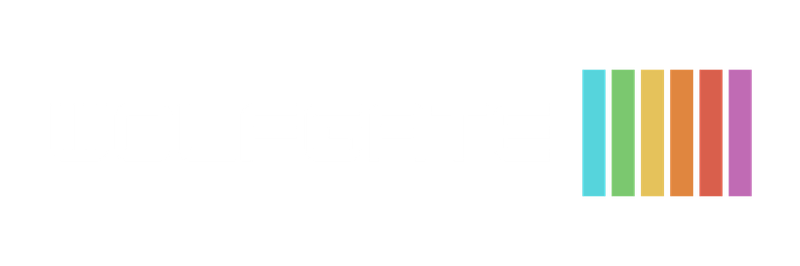

<!-- WOLFGATE(Branding) START: rebrand from Monolith to Wolfgate -->

Wolfgate is a fork of [Monolith](https://github.com/Monolith-Station/Monolith), itself a fork of [Frontier Station 14](https://github.com/new-frontiers-14/frontier-station-14), running on the [Robust Toolbox](https://github.com/space-wizards/RobustToolbox) engine written in C#.

This is the primary repo for Wolfgate.

If you want to host or create content for Wolfgate, this is the repo you need. It contains both RobustToolbox and the content pack.
<!-- WOLFGATE END -->

## Links

<!-- WOLFGATE(Branding): dropped Monolith's Discord link -->
[Steam](https://store.steampowered.com/app/1255460/Space_Station_14/)

<!-- WOLFGATE(Branding): link to the contributor guidelines -->
[Guide to Modularisation and Wolfgate](Wolfgate%20Guidelines.md)

## Contributing

<!-- WOLFGATE(Branding) START: rebrand contributing section -->
Contributions are welcome. Wolfgate-specific code lives in `_WG` folders, and edits to upstream files are marked with `// WOLFGATE` comments so they are easy to find when merging from Monolith.

We are not accepting translations on this repository.
<!-- WOLFGATE END -->

<!-- WOLFGATE(Contributing): link the AI content policy -->
AI use in contributions is covered by the [AI-generated content policy](Docs/_WG/Contributing/AI_POLICY.md).

## Building

<!-- WOLFGATE START: reworded for Wolfgate build differences -->
Refer to [the Space Wizards' guide](https://docs.spacestation14.com/en/general-development/setup/setting-up-a-development-environment.html) for setting up a development environment. Most of it applies, but Wolfgate is not upstream Space Station 14, so some details differ.
The scripts below make the job easier.
<!-- WOLFGATE END -->

### Build dependencies

> - Git
> - .NET SDK 10.0

### Windows

> 1. Clone this repository
> 2. Run `Scripts/bat/updateEngine.bat` in a terminal or in file explorer to download the engine
> 3. Run `Scripts/bat/buildAllDebug.bat` after making any changes to the source
> 4. Run `Scripts/bat/runQuickAll.bat` to launch the client and the server
> 5. Connect to localhost in the client and play

### Linux

> 1. Clone this repository
> 2. Run `Scripts/sh/updateEngine.sh` in a terminal to download the engine
> 3. Run `Scripts/sh/buildAllDebug.sh` after making any changes to the source
> 4. Run `Scripts/sh/runQuickAll.sh` to launch the client and the server
> 5. Connect to localhost in the client and play

### MacOS

> 1. Clone this repository
> 2. Run `Scripts/sh/updateEngine.sh` in a terminal to download the engine
> 3. Run `Scripts/sh/buildAllDebug.sh` after making any changes to the source
> 4. Run `Scripts/sh/runQuickAll.sh` to launch the client and the server
> 5. Connect to localhost in the client and play

## License

<!-- WOLFGATE(Branding) START: reworded license section for Wolfgate branding -->
See the REUSE headers for detailed licensing information for each file. The work as a whole is licensed under the GNU Affero General Public License version 3.0.

Licensing inherited from Monolith and Frontier:

- Original code contributed to the Monolith codebase after 04d8ce483f638320d1b85a7aaacdf01442757363 is under the Mozilla Public License version 2.0 with Exhibit B removed. See `LICENSES/MPL-2.0.txt`.
- Content contributed after commit 2fca06eaba205ae6fe3aceb8ae2a0594f0effee0 is licensed under the GNU Affero General Public License version 3.0, unless otherwise stated. See `LICENSES/AGPL-3.0-or-later.txt`.
- Content contributed before commit 2fca06eaba205ae6fe3aceb8ae2a0594f0effee0 is licensed under the MIT license, unless otherwise stated. See `LICENSES/MIT.txt`.

[2fca06eaba205ae6fe3aceb8ae2a0594f0effee0](https://github.com/new-frontiers-14/frontier-station-14/commit/2fca06eaba205ae6fe3aceb8ae2a0594f0effee0) was pushed on July 1, 2024 at 16:04 UTC.

Most assets are licensed under [CC-BY-SA 3.0](https://creativecommons.org/licenses/by-sa/3.0/) unless stated otherwise. Assets have their license and copyright in the metadata file. [Example](https://github.com/space-wizards/space-station-14/blob/master/Resources/Textures/Objects/Tools/crowbar.rsi/meta.json).

Some assets are licensed under the non-commercial [CC-BY-NC-SA 3.0](https://creativecommons.org/licenses/by-nc-sa/3.0/) or similar non-commercial licenses and will need to be removed if you wish to use this project commercially.
<!-- WOLFGATE END -->

<!-- WOLFGATE START: credit the Starlight licence and the Goonstation-derived reactor -->
Code under `_Starlight` folders, and the Starlight-derived parts of `_FarHorizons`, was contributed to Starlight between 2024-11-04 and 2026-02-28 and is under the Starlight License (Wolfgate's own edits there are marked `WOLFGATE` and are under the AGPL), a modified MIT license that requires attributing the Starlight project as its source: https://github.com/ss14Starlight/space-station-14. See `LICENSES/LicenseRef-Starlight.txt`.

The nuclear reactor code under `_FarHorizons/Power/Generation/FissionGenerator` is ported from Goonstation and is labelled MIT, following HardLight commit b602e8d485, which records permission from jhrushbe, rottenheadphones and taydeo. Assets whose metadata names Goonstation as their source are under [CC-BY-NC-SA 3.0](https://creativecommons.org/licenses/by-nc-sa/3.0/).
<!-- WOLFGATE END -->
